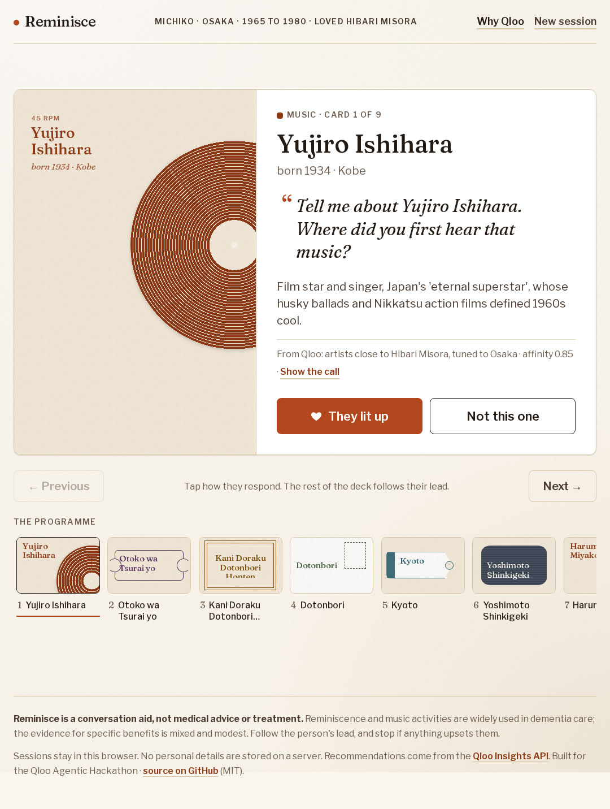
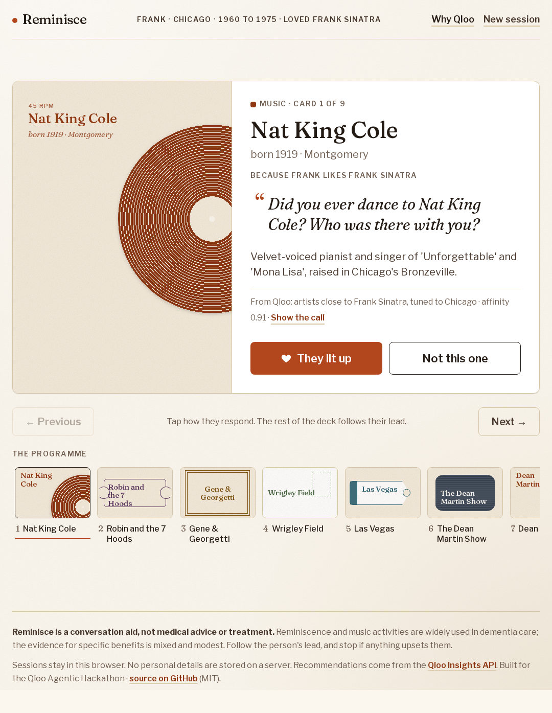
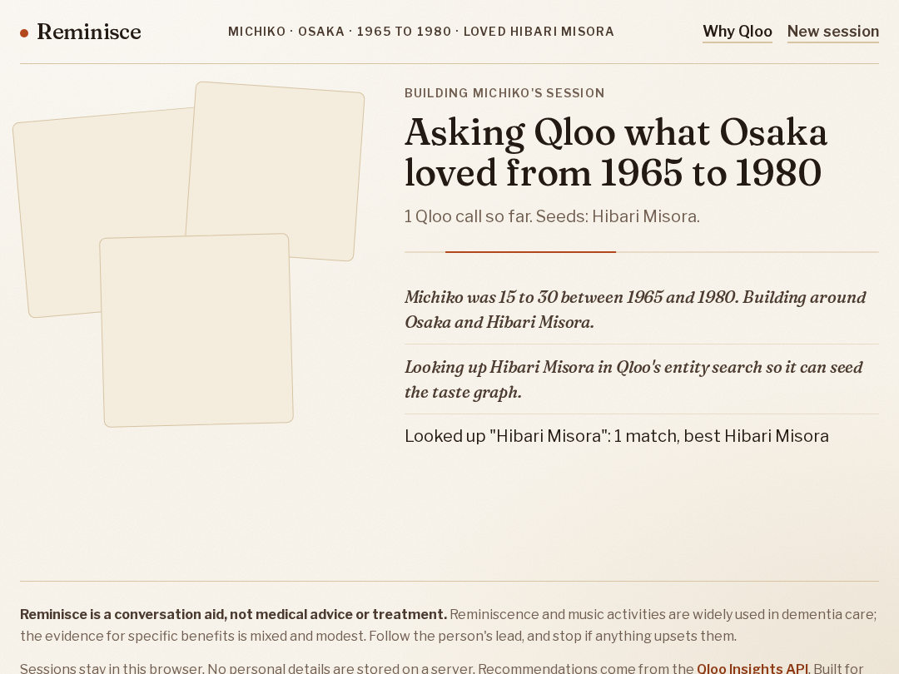
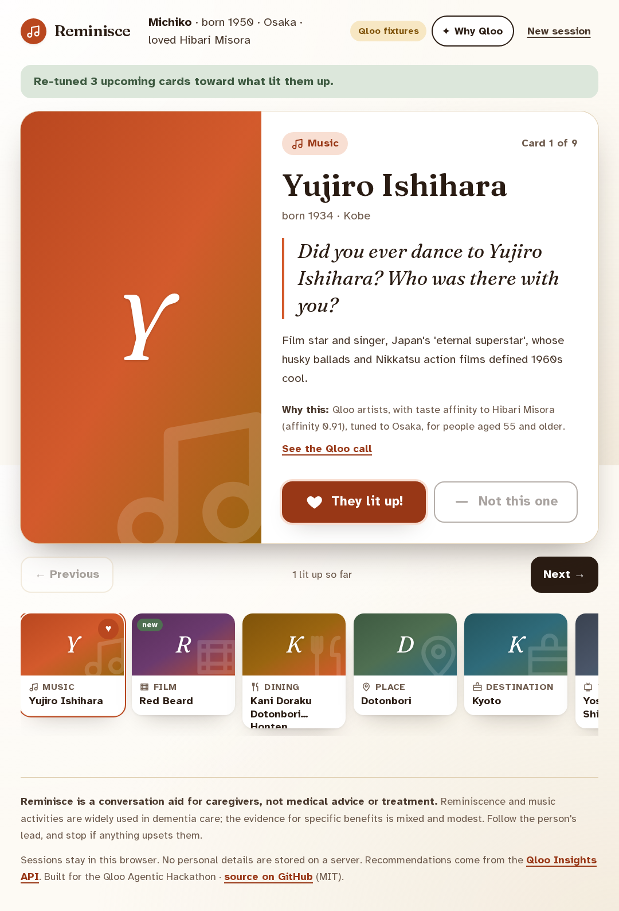
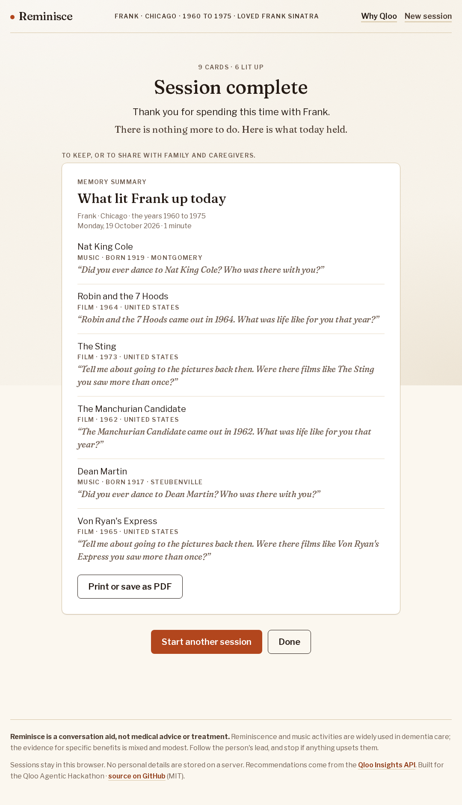
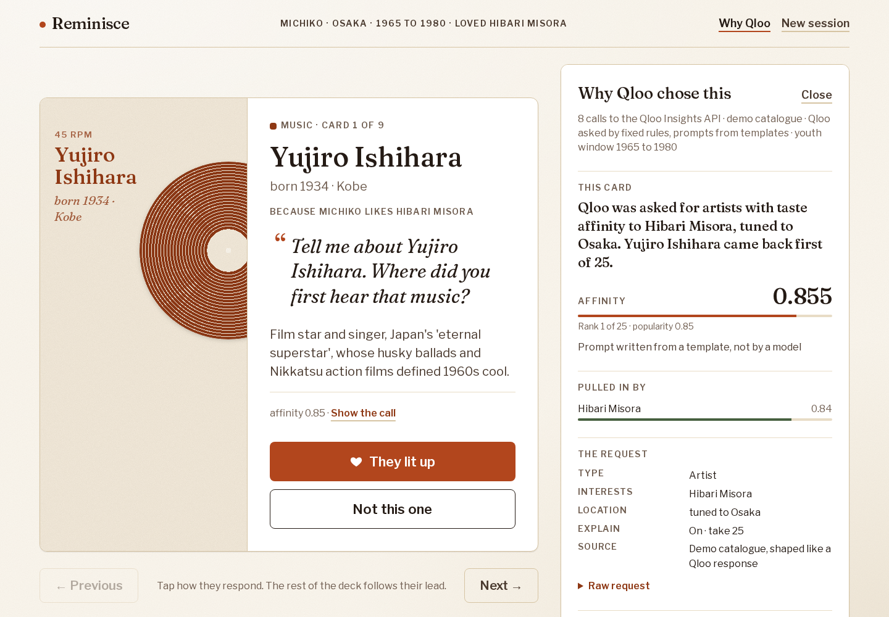

# Reminisce

**Music and memories from when they were 20.**
A cultural memory session builder for dementia caregivers, driven by an agent that plans with the [Qloo Insights API](https://docs.qloo.com/) and re-tunes live as the person responds.

Built for the Qloo Agentic Hackathon. MIT licensed.



## What it is

A caregiver (a daughter, a care-home activity coordinator) enters three things about a loved one: the year they were born, where they grew up, and one to three things they loved. Reminisce works out the years they were 15 to 30, the "reminiscence bump" where autobiographical memory is densest, and asks the Qloo taste graph what their generation and their hometown adored. The result is a 20-minute deck of 8 to 10 cards: singers, films, TV shows, dishes and restaurants, local landmarks and destinations. Each card carries a gentle, open conversation prompt in the person's language.

During the session the caregiver taps **They lit up** or **Not this one**. The agent goes back to Qloo with the liked entity as a new signal (or the disliked one excluded), and swaps the upcoming cards while a visible "re-tuning" state shows what it is doing. A **Why Qloo** panel exposes every call: the endpoint, entity type, signals, filters, affinity score and Qloo's explainability breakdown of which seed pulled each item in.



Two presets let you try it in one tap. Michiko (born 1950, Osaka, loved Hibari Misora) and Frank (born 1945, Chicago, loved Frank Sinatra) get sessions that differ end to end: Japanese singers, Japanese films of 1965 to 1980, Osaka's own landmarks and a trip for Michiko; standards singers, American films and television of 1960 to 1975, Chicago's own landmarks and a trip for Frank. Which exact names turn up is Qloo's answer on the day.

## Why Qloo is essential

Reminisce cannot be built on an LLM alone, and the reason is the centre of the product:

- **Taste affinity across domains.** Knowing someone loved Hibari Misora says something about the films, the places and the food they are likely to light up at. Only a cross-domain taste graph can follow that thread from an artist to a 1960s Nikkatsu film to a Dotonbori restaurant. An LLM can guess, but it cannot score, rank or explain.
- **Location as a signal, not a filter.** `signal.location.query=Osaka` biases every domain toward what Osaka's own taste profile favours, which is why Michiko gets Yoshimoto comedy and Frank gets the Chicago Theatre instead of a generic "best of the 60s" list.
- **Demographic signals.** `signal.demographics.age=55_and_older` tunes results toward what that cohort has affinity for.
- **Explainability.** `feature.explainability=true` returns, per entity, how much each seed contributed. Reminisce shows this in the Why Qloo panel so a caregiver understands why a card is there, and the agent's reasoning is auditable rather than a black box.
- **Live adaptation.** When a card lands, the liked entity goes straight back into `signal.interests.entities`. The deck re-tunes from real affinity data in a second, something no static playlist can do.
- **Privacy by design.** Qloo works on cultural entities, not on the person. Reminisce never sends a name, a birth year or a diagnosis anywhere. The only things that leave the browser are entity ids, a city name and an age bucket.

The LLM's job is narrower and genuinely agentic: decide which Qloo calls to make, interpret the results, choose and order the cards, and write the prompts. Everything factual on a card comes from Qloo.

## How the agent works

```
caregiver intake ──► /api/plan ──────────────────────────────────────────────┐
  name, birth year,     │                                                     │
  hometown, favorites   ▼                                                     │
                 ┌───────────────────────────────────────────────┐            │
                 │ agent loop (LLM policy, or deterministic one) │            │
                 │                                               │            │
                 │  1. qloo_search_entity  favorites → ids       │  GET /search
                 │     qloo_search_entity  hometown  → locality  │            │
                 │  2. qloo_search_tags    "restaurant", ...     │  GET /v2/tags
                 │  3. qloo_insights × N   artist, movie,        │  GET /v2/insights
                 │        tv_show, place (dining), place         │    signal.interests.entities
                 │        (landmarks), destination               │    signal.location.query
                 │        with seeds + hometown + age signals    │    signal.demographics.age
                 │        and youth-window year filters          │    filter.release_year.*
                 │  4. plan_session        8–10 cards, ≥3 domains│    feature.explainability
                 └───────────────┬───────────────────────────────┘            │
                                 │ NDJSON stream: every tool call,            │
                                 │ every Qloo request and result,             │
                                 ▼ then the plan                              │
                       card deck in the browser  (localStorage)               │
                                 │                                            │
      tap ❤ / 👎 ────────► /api/adapt                                         │
                                 │  qloo_insights with the liked entity       │
                                 │  added to signal.interests.entities        │
                                 │  (or the disliked one excluded)            │
                                 │  adapt_session → replace upcoming cards ◄──┘
                                 ▼
                       deck re-tuned; trace appended to the Why Qloo panel
```



The loop is a real tool-calling loop. The model (any OpenAI-compatible chat model with function calling) sees five tools and nothing else; it cannot invent an entity because `plan_session` and `adapt_session` only accept entity ids that an earlier `qloo_insights` call returned in this session. Every step is emitted as a trace event and streamed to the browser as NDJSON, so the planning screen shows the agent thinking and the Why Qloo panel keeps the full timeline.

| Tool | What it does | Qloo call |
| --- | --- | --- |
| `qloo_search_entity` | Resolve a favorite or hometown to a Qloo entity (with `urn:entity:locality` for places) | `GET /search` |
| `qloo_search_tags` | Find tag ids such as the restaurant genre before filtering by them | `GET /v2/tags` |
| `qloo_insights` | Recommendations for one entity type with seed, location, demographic and year parameters, explainability on | `GET /v2/insights` |
| `plan_session` | Commit 8 to 10 cards across at least 3 domains, each with a prompt | none |
| `adapt_session` | Replace up to 3 upcoming, unreacted cards after feedback | none |

When no LLM key is configured, or the model fails or misbehaves, the session is built without it. If the model had already fetched enough from Qloo, the deck is chosen from those results with no new calls; otherwise the same loop runs a deterministic policy that performs the same tool calls in a fixed order and writes prompts from templates. In the Why Qloo panel, every step in the "How this session was built" timeline carries a small word naming the policy that produced it ("model" or "scripted"), and the panel's "This card" section notes "Prompt written from a template, not by a model" when a card's prompt came from a template. The deterministic policy is also what the unit tests and the fixture-mode demo use, so the demo never depends on model latency or availability.

### Youth window and age signal

- Youth window: birth year + 15 to birth year + 30, capped at the current year. Michiko (1950) gets 1965 to 1980; Frank (1945) gets 1960 to 1975. Applied as `filter.release_year.min/max` on films and TV (TV reaches back five more years). The `qloo_insights` tool enforces it whatever the policy asks: missing year filters are filled in, wider ones narrowed, and artists who started (`start_year`) after the window, or were born too late to perform in it, are left out.
- Thin answers: when a call returns fewer than three entities, the tool widens it itself, one step at a time and never past the era. Live Qloo returns no TV shows for a location signal combined with release years, so TV is asked again without `signal.location.query`; films try that, then any release country; places drop the seed. The trace shows each step. A domain that stays empty is skipped, and if a run ends with too little for a deck the caregiver sees a kind empty state with a way to try again.
- Age signal: the person's age today mapped to the documented `signal.demographics.age` buckets (`24_and_younger`, `25_to_29`, `30_to_34`, `35_to_44`, `45_to_54`, `55_and_older`).

## Qloo endpoints and parameters

Base URL `https://hackathon.api.qloo.com`, header `X-Api-Key`. Only the documented hackathon endpoints are used.

| Endpoint | Used for | Docs |
| --- | --- | --- |
| `GET /search` | Entity autocomplete in the intake form; resolving favorites and the hometown locality | [Search](https://docs.qloo.com/reference/get-search) |
| `GET /v2/tags` | Finding tag ids (restaurant, landmark) to pass as `filter.tags` | [Tags search](https://docs.qloo.com/reference/search-tags) |
| `GET /v2/insights` | Every recommendation | [Insights deep dive](https://docs.qloo.com/reference/insights-api-deep-dive), [Parameter reference](https://docs.qloo.com/reference/parameters) |

The [hackathon guide](https://docs.qloo.com/reference/qloo-llm-hackathon-developer-guide) warns that invalid parameters are silently ignored. Reminisce therefore validates every Insights parameter against two documents before sending it: the per-type tables in the [Entity Type Parameter Guide](https://docs.qloo.com/reference/available-parameters-by-entity-type) and the "Compatible Entity Types" column of the [Parameter Reference](https://docs.qloo.com/reference/parameters). Anything not listed for the requested `filter.type` is dropped and reported as a warning in the trace instead of being sent. The tables live in [`src/lib/qloo/params.ts`](src/lib/qloo/params.ts) and are unit-tested.

Parameters Reminisce actually sends, per entity type:

| `filter.type` | Signals | Filters | Output |
| --- | --- | --- | --- |
| `urn:entity:artist` | `signal.interests.entities`, `signal.location.query`, `signal.demographics.age` | `filter.exclude.entities` | `feature.explainability`, `take` |
| `urn:entity:movie` | same | `filter.release_year.min`, `filter.release_year.max`, `filter.release_country`, `filter.exclude.entities` | same |
| `urn:entity:tv_show` | same | `filter.release_year.min`, `filter.release_year.max`, `filter.release_country`, `filter.exclude.entities` | same |
| `urn:entity:place` (dining) | same | `filter.location.query` (hometown), `filter.tags` (restaurant genre from `/v2/tags`), `filter.exclude.entities` | same |
| `urn:entity:place` (landmarks) | `signal.demographics.age` only (the seed's taste pulls in modern venues) | `filter.location.query`, `filter.tags` (tourist-attraction and landmark genres from `/v2/tags`), `filter.exclude.entities` | same |
| `urn:entity:destination` | same | `filter.exclude.entities` (plus `filter.geocode.country_code` when the hometown resolves to a country) | same |

Deliberately not sent: `filter.release_year` on artists (undocumented for that type, and the guard would drop it), `filter.location.query` on media types (unsupported; the hometown goes in as `signal.location.query` instead), and any parameter from the general Parameter Reference that the hackathon guide does not list.

Qloo's [schema and taxonomy](https://docs.qloo.com/reference/schema-taxonomy) and the [location use case](https://docs.qloo.com/reference/insights-with-location-use-case) informed which fields the cards read: `name`, `properties.image.url`, `properties.release_year`, `properties.date_of_birth`, `properties.geocode`, `properties.description`, `tags`, `popularity`, `query.affinity` and `query.explainability`.

Per the hackathon FAQ, Qloo response data is not stored in this public repository. Recorded fixtures are git-ignored (see below).

## Running it

Requires Node 20 or later.

```bash
npm install
cp .env.example .env.local     # optional; the defaults run fully offline
npm run dev                    # http://localhost:3000
```

With no keys configured the app runs in **fixture mode**: every Qloo call is answered by a local, deterministic fixture engine and the agent uses the deterministic policy. Both presets, the intake form, autocomplete, adaptation and the Why Qloo panel all work offline.

### Environment variables

| Variable | Default | Purpose |
| --- | --- | --- |
| `QLOO_API_KEY` | unset | Hackathon API key. Never commit it; `.env.local` is git-ignored. |
| `QLOO_MODE` | auto | `live` or `fixture`. Unset means live when a key is present, fixture otherwise. |
| `QLOO_BASE_URL` | `https://hackathon.api.qloo.com` | Override only if Qloo moves the hackathon host. |
| `LLM_API_KEY` | unset | Key for an OpenAI-compatible chat completions endpoint with tool calling. |
| `LLM_MODE` | auto | `live` or `fixture`. Unset means live when a key is present. |
| `LLM_BASE_URL` | `https://api.openai.com/v1` | Any provider that speaks `/chat/completions` (OpenAI, OpenRouter, Groq, Together, a local server). |
| `LLM_MODEL` | `gpt-4o-mini` | Model name sent to that endpoint. |
| `NEXT_PUBLIC_SITE_URL` | derived | Absolute site URL for Open Graph tags. Vercel's production URL is used when unset. |
| `UPSTASH_REDIS_REST_URL`, `UPSTASH_REDIS_REST_TOKEN` | unset | Upstash Redis for the daily budget and preset snapshots (the Vercel Marketplace integration sets them; `KV_REST_API_URL` / `KV_REST_API_TOKEN` work too). Unset means no budget and no snapshots. |
| `BUDGET_LLM_PLANS_PER_DAY` | `40` | Model-written sessions allowed per UTC day. Past it, the deterministic planner writes template prompts. `unlimited` removes the cap. |
| `BUDGET_LLM_ADAPTS_PER_DAY` | `120` | Model-driven re-tunes per UTC day; same fallback. |
| `NEXT_PUBLIC_BOTID` | unset | `off` disables Vercel BotID on `/api/plan` and `/api/adapt` (client and server). |
| `BUDGET_QLOO_CALLS_PER_DAY` | `600` | Live Qloo calls per UTC day (cached answers are free). Past it, sessions come from the offline catalog with a note in the header. |

Switching to live Qloo is a pure environment change: set `QLOO_API_KEY` (and optionally `QLOO_MODE=live`) and restart. No code path differs.

### Fixture mode, recording and the synthetic catalog

Fixture mode has two layers:

1. **Recorded responses** in `fixtures/recorded/`, written by `npm run record` from the real API. Each file is keyed by a hash of the exact request (path plus sorted parameters) and replayed verbatim. These files are Qloo data and are git-ignored on purpose.
2. **A synthetic catalog** in `fixtures/synthetic/`, hand-authored and clearly marked `"synthetic": true` in each file's `_meta`. It is shaped exactly like Qloo responses (`results.entities[]` with `entity_id`, `subtype`, `properties`, `tags`, `popularity`, `query.affinity`, `query.explainability`) so the UI, the agent and the tests exercise the real code paths. Entity ids are obviously fake (`ffffffff-…`). A small scorer applies the same signals the live API would (seed relation, location, tags, year filters, age era) so that Michiko and Frank get different, coherent sessions even without a key.

   The catalog covers nine cultural worlds, about 1,200 entities in all: Japan, the United States, the United Kingdom and Ireland, Latin America (Mexico, Argentina, Brazil, Colombia, Peru, Cuba, Chile, Uruguay), the Philippines, India and Pakistan, Korea, the Chinese-speaking world (Hong Kong, Taiwan, mainland China, Singapore) and an international set. Sixty cities resolve as localities with their own restaurants and landmarks; any other town is placed by country through `regions.json` (Puebla is Mexico, Sheffield is England, Pune is India), so it still gets the right music, films and trips and never another city's streets. A typed favourite the catalog knows (Pedro Infante, Pilita Corrales, Lata Mangeshkar, Teresa Teng…) seeds the deck and shows up in the explainability of what it pulled in. A hometown nowhere near a regional world (Madrid, Berlin) gets international names only, never a deck from somewhere else. All of it is marked synthetic and none of it is Qloo data.

To capture real responses once a key exists:

```bash
QLOO_API_KEY=… npm run record                      # both presets, their adaptations and autocomplete searches
QLOO_API_KEY=… npm run record -- --preset frank
QLOO_API_KEY=… npm run record -- --search "Edith Piaf" --search "Lyon"
QLOO_API_KEY=… npm run record -- --live              # live-Qloo regression people, into fixtures/live/ (git-ignored)
```

Then `QLOO_MODE=fixture` replays the recordings and falls back to the synthetic catalog only for requests that were never recorded. The Why Qloo panel says where each answer came from in plain words: a live session says "live Qloo API" and nothing more; a replay says "replayed from saved Qloo responses" or "demo catalogue". Those strings live in one place, `src/lib/session/provenance.ts`, with their translations in the dictionaries.

### The LLM

The agent calls `${LLM_BASE_URL}/chat/completions` with the five tools above, `tool_choice: "auto"`, and the person's details in the user prompt (no name is needed by the model, but it is included so prompts can address the person; nothing is stored). Up to two nudges are sent if the model stops without committing a plan. If the model errors, times out, or exceeds the step budget, the trace records why and the deterministic policy takes over, so the caregiver always gets a deck.

`LLM_MODE=fixture` (or no key) skips the model entirely.

## Live adaptation

Tapping **They lit up** on a card:

1. marks it, puts the deck into the animated re-tuning state and streams `/api/adapt`;
2. the agent calls `qloo_insights` for the same domain and one other domain with the liked entity added to `signal.interests.entities` and every entity already in the deck in `filter.exclude.entities`;
3. `adapt_session` replaces up to three upcoming, unreacted cards (same domain first), never a card already shown or reacted to, and keeps at least three domains in the deck;
4. the replaced cards slide into the deck strip marked **new**, and the trace is appended to the Why Qloo panel.

**Not this one** excludes that entity and steers the next cards of that domain toward a different domain (the last one that lit up, if any).



When every card has a reaction, the session closes with a keepsake: what lit them up, each with its prompt, ready to print for the care file.



## Why Qloo panel

Open from the header or from "Show the call" on any card. For the current card it shows the entity type, the source (live, a saved response or the demo catalogue), affinity with a bar, rank and popularity, Qloo's explainability per seed, and every signal, filter and output parameter that was sent. Below it is the full agent timeline: narration, each tool call with its arguments, each Qloo request with its parameters, result counts and durations, and any parameters the validator dropped. Escape closes it; it is a complementary landmark and keyboard reachable.



## Languages

The language chosen on the intake form is the language of the whole session, not only of the prompts: the card chrome, the buttons, the programme strip, the notices, the keepsake and the Why Qloo panel all switch, and the session root carries a matching `lang` attribute for screen readers. English, Spanish and Japanese ship as three typed dictionaries in `src/lib/i18n/` (one interface, three files, no framework); a unit test fails if a language is missing a key. The agent's own log lines in the timeline stay as written, since they are the trace rather than the interface.

## Accessibility and design

Designed for a tablet on a care-home table, used by someone whose eyes and hands are busy:

- 18px base type, Libre Franklin for text, Fraunces for display; one ink and one accent (ember) with WCAG AA contrast on every pairing against the paper background. Domain inks appear only on the sleeves and the 10px swatch beside a label, never behind text.
- Every control is at least 44px tall, named, and reachable by keyboard; left and right arrows move between cards.
- Live regions announce planning progress, re-tuning and notices; the trace panel is a labelled complementary region; the deck strip is navigation with per-card labels including the reaction.
- No animation on load. `prefers-reduced-motion` removes the 160ms card crossfade and the moving re-tuning rule.
- Qloo image URLs are shown as a matted photograph; without one, each card gets a printed sleeve for its domain (album sleeve, ticket stub, menu card, postcard, luggage label, television) with the title set in type, so no card is ever a grey box.
- Works from phone portrait to desktop; the trace panel sits below the card on small screens and in a side column on wide ones.
- When every card has a reaction, a keepsake lists what lit them up with its prompt and prints cleanly for the care file.

## Privacy

No personal data touches a server. Sessions (the person's details, cards, reactions and trace) live in the browser's localStorage. The API routes are stateless: they receive the session for the duration of one request, call Qloo, and stream the result back. Qloo only ever sees entity ids, a city name and an age bucket.

## Evidence and caveat

Reminiscence work and music are widely used in dementia care, and the evidence base is real but modest:

- Woods B, O'Philbin L, Farrell EM, Spector AE, Orrell M. *Reminiscence therapy for dementia.* Cochrane Database of Systematic Reviews 2018, Issue 3, CD001120. [doi:10.1002/14651858.CD001120.pub3](https://doi.org/10.1002/14651858.CD001120.pub3). The review found effects that were inconsistent across studies and often small, with some evidence of benefits to quality of life, cognition, communication and mood, varying by setting and format.
- van der Steen JT, Smaling HJA, van der Wouden JC, Bruinsma MS, Scholten RJPM, Vink AC. *Music-based therapeutic interventions for people with dementia.* Cochrane Database of Systematic Reviews 2018, Issue 7, CD003477. [doi:10.1002/14651858.CD003477.pub4](https://doi.org/10.1002/14651858.CD003477.pub4). Music-based interventions of at least five sessions probably reduce depressive symptoms and may improve overall behavioural problems; little or no effect was found on agitation or aggression.

**Reminisce is a conversation aid for caregivers. It is not medical advice, therapy or treatment, and it does not diagnose or monitor anything.** Follow the person's lead and stop if anything upsets them.

## Tests

```bash
npm run check      # typecheck + lint + unit tests
npm test           # vitest: Qloo parameter building and validation, youth window and age bucket,
                   #         fixture engine shape, client live/fixture behaviour, planner domain mix,
                   #         adaptation (liked entity as signal, only upcoming cards replaced),
                   #         daily budget and breaker, guard degradation ladder, response cache,
                   #         preset snapshots and replay, live-Qloo regressions (thin and empty answers,
                   #         era enforcement, running out of time; replays fixtures/live/ when present),
                   #         planning-view progress
npm run test:e2e   # Playwright, fixture mode, tablet viewport: both presets end to end
                   #         (plan → cards → Why Qloo → reaction → re-tune → reload persistence),
                   #         preset difference, intake autocomplete + a Spanish session, a Mexico City
                   #         custom person, auto-advance, the programme strip, unknown session,
                   #         the empty state when Qloo has too little
```

The Playwright run builds the app and starts it on port 3100 with `QLOO_MODE=fixture` and `LLM_MODE=fixture`.

## Deploying to Vercel

`vercel.json` sets the framework; nothing else is required. Import the repository, then set the environment variables above in the project settings (`QLOO_API_KEY` and, if you want the model, `LLM_API_KEY`, `LLM_BASE_URL`, `LLM_MODEL`). Leave `QLOO_MODE` unset so the deployment goes live the moment the key exists. The API routes declare `maxDuration` (60 s for plan and adapt) and the agent keeps one 50 s budget inside that, shared by the LLM loop, the deterministic fallback and every live Qloo request (the last 15 s are held back so the fallback can always finish). `fixtures/synthetic` is included in the function bundle via `outputFileTracingIncludes` so fixture mode also works when deployed.

For a public demo, add the free Upstash Redis integration from the Vercel Marketplace and read the next section.

## Keeping the demo affordable

The three API routes are public and need no login, so anyone could loop them and burn the model credit or the Qloo key's quota. Six layers keep the bill bounded while judges see the same product. None of them changes what a session is; all of them are off when their configuration is absent, so local development, the tests and fixture mode run exactly as before.

1. **Edge rules, no code.** In the Vercel dashboard: one WAF rate-limit rule on `/api/*` (40 requests per minute per IP), the Bot Protection managed ruleset in Challenge mode and the AI Bots ruleset in Deny mode. Blocked requests never invoke a function.
2. **Every live Qloo answer is cached.** The live client wraps each `GET` in Next.js's persistent fetch cache (`unstable_cache`, which on Vercel is the Data Cache: shared by every function instance, kept across deployments, free on all plans). Entries live 30 days under the tag `qloo`; the hackathon guide allows private server-side caching with no time limit. Only `200` answers are stored, so a "no results" search is asked again. A preset's plan therefore costs Qloo nothing after its first run, and a repeated autocomplete query nothing at all. `/api/search` additionally sends `Cache-Control: public, max-age=120, s-maxage=86400, stale-while-revalidate=604800`, so the CDN answers repeats without invoking the function. The Why Qloo panel marks cached calls.
3. **A global daily budget with graceful degradation.** Three counters in Upstash Redis, one per UTC day (`INCR` + `EXPIRE`, keyed `reminisce:budget:<kind>:<day>`), bound the whole demo's spend regardless of how many visitors there are: model-written plans, model-driven re-tunes, and live Qloo calls that the cache did not answer. The caps are the `BUDGET_*` variables above. The ladder when a cap is reached:
   - model budget spent: the deterministic planner builds the session through the same tools, and the panel labels every prompt as template-written;
   - Qloo budget spent, or a Qloo call answering 429, 5xx or timing out: the synthetic catalog answers instead, and the session header carries a quiet line ("Reminisce has had a busy day. This session uses the offline catalog; Qloo returns tomorrow.").
   Never an error page. The budget fails safe: with no Redis configured there is no budget; with Redis configured but unreachable, the cheap path is taken for a minute at a time.
4. **Preset snapshots.** Michiko's and Frank's first live run of the day is kept in Redis for 24 hours (`reminisce:preset:<id>:v1`), and later visitors get it replayed: the trace streams again with a short gap between events so the planning view still animates, the cards and their Qloo provenance are the same, and the trace and the Why Qloo panel say "Replayed from a live Qloo run at 09:14 UTC on 5 November". Only a full-strength run is kept, never a degraded one or one where the configured model fell back to the deterministic planner, and re-tunes on a preset stay live. Nothing is written to the repository: the guide forbids Qloo data in public repositories.
5. **A smaller model loop.** The model gets 12 completions for a plan and 8 for a re-tune (was 22), `max_tokens: 1500` per completion, and a system-prompt line asking for all `qloo_insights` calls as parallel tool calls in one turn. The deterministic planner takes over when the cap is reached, as it does on any model error.
6. **Vercel BotID (Basic).** `src/instrumentation-client.ts` attaches an invisible classification to the browser's own calls to `/api/plan` and `/api/adapt` (production builds only, so development stays offline-capable), and each route answers `403` to a bot. The server check runs only on Vercel and fails open, so a classifier hiccup can never cost a human their session; the daily budget bounds whatever gets by. `NEXT_PUBLIC_BOTID=off` turns it off on both sides.

Residual risk is a headless-browser farm rotating IPs: it passes the challenge and the classifier, then burns the day's budget in minutes, and the demo degrades (rather than going down or burning the key) until midnight UTC.

## Technical choices

- **Next.js 16.4** (the current stable release at build time, October 2026) with the App Router, Cache Components and Turbopack; React 19.3. The home page is fully static; the session page is a partial prerender whose client view reads localStorage after hydration. The API routes are Node route handlers that stream NDJSON.
- TypeScript strict with `noUncheckedIndexedAccess`; zod 4 for request validation and for generating the tool JSON schemas sent to the model.
- Tailwind CSS 4 via the Turbopack loader with a small set of theme tokens; `next/font` for self-hosted fonts.
- Vitest for unit tests, Playwright for end to end.

## Project structure

```
src/app/                 pages, layout, API routes (/api/plan, /api/adapt, /api/search)
src/components/home/     intake form, Qloo autocomplete, presets
src/components/session/  memory card, deck strip, planning and re-tuning views, Why Qloo panel
src/lib/qloo/            client (live + fixture), response cache, parameter validation tables, fixture engine, place-name matching, types
src/lib/agent/           tool definitions, tool execution + entity pool, loop, LLM and scripted policies, prompts
src/lib/session/         person/session types, youth window, presets, localStorage, zod schemas, deck size, provenance wording, auto-advance
src/lib/i18n/            typed UI dictionaries: en, es, ja
src/lib/guard/           daily budget and breaker (Upstash), per-request guard, preset snapshots, BotID check
fixtures/synthetic/      hand-authored synthetic catalog, nine worlds (committed, marked synthetic)
fixtures/recorded/       real responses from `npm run record` (git-ignored)
fixtures/live/           real responses from `npm run record -- --live` (git-ignored)
scripts/record.ts        recorder
tests/unit, tests/e2e    vitest and Playwright suites
```

## License

MIT. See [LICENSE](LICENSE).
